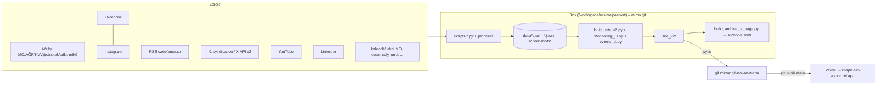
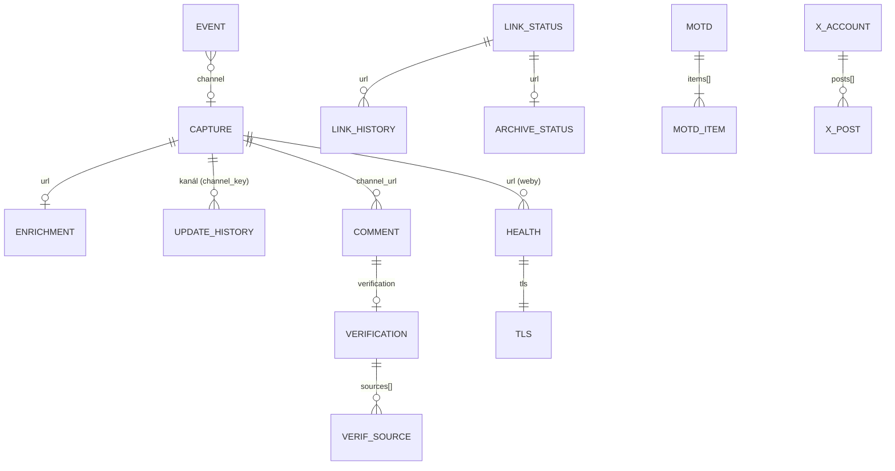

# Mapa kanálů AČR / Aktivní zálohy – kompletní specifikace

> Stav k 30. 10. 2026. Popis vychází ze skutečného kódu (`pipeline/build_site_v2.py`, `pipeline/monitoring_ui.py`,
> `pipeline/events_ui.py`, `pipeline/scripts/*.py`) a skutečných dat (`pipeline/data/`). Kde něco není
> implementováno, je to výslovně uvedeno.

Živý web: <https://mapa-acr-az.vercel.app> · repozitář: `michalbcz/acr-az-mapa` (větev `main` = produkce).

## Obsah

1. [Účel a publikum](#1-účel-a-publikum)
2. [Architektura v kostce](#2-architektura-v-kostce)
3. [Stránka a její sekce](#3-stránka-a-její-sekce)
4. [Kategorizace a oficiálnost kanálů](#4-kategorizace-a-oficiálnost-kanálů)
5. [Zdroje dat](#5-zdroje-dat)
6. [Denní pipeline](#6-denní-pipeline)
7. [Datový model](#7-datový-model)
8. [Build a publikace](#8-build-a-publikace)
9. [Čas na klientovi (`time.reltime[data-iso]`)](#9-čas-na-klientovi)
10. [Pravidla soukromí](#10-pravidla-soukromí)
11. [Politika komentářů a ověřování](#11-politika-komentářů-a-ověřování)
12. [Archivace (archive.org / archive.is)](#12-archivace)
13. [Známé problémy a limity](#13-známé-problémy-a-limity)
14. [Jak aplikaci postavit znovu](#14-jak-aplikaci-postavit-znovu)
15. [Příloha A – pole datových souborů (odvozeno z reálných dat)](#příloha-a--pole-datových-souborů)

---

## 1. Účel a publikum

**Účel.** Jedna veřejná statická stránka, která mapuje veřejné (a evidenčně i uzavřené) komunikační kanály
Armády ČR (AČR), Ministerstva obrany (MO), Aktivní zálohy (AZ), krajských vojenských velitelství (KVV),
jednotek AZ, dobrovolnických a partnerských organizací (ARDOS, POKOS, SVZ, ČsOL, RESCO…) a odborných
médií/analytiků. Pro každý kanál ukazuje snímek obrazovky, poslední příspěvek (titulek, autor, datum,
permalink), technická metadata webu (CMS, HTTP hlavičky, SSL certifikát, dostupnost) a historii příspěvků.
Nad tím jsou průřezové pohledy: chronologie, feed, histogram, zajímavé komentáře s ověřením faktů,
dostupnost a SSL, kontrola odkazů, události s exportem do kalendáře a denní shrnutí „Zpráva dne“.

**Publikum.** Zájemci o službu v AZ a vojáci AZ, novináři a analytici obranné komunikace, lidé, kteří
chtějí na jednom místě vidět, co a kde armáda/MO komunikuje, a správce mapy (Michal Bernhard).
Stránka je česky, bez přihlášení, bez cookies a bez backendu.

**Principy.**
- Nic se nevymýšlí: každý příspěvek, datum, odkaz a událost pochází z otevřeného zdroje; prázdný stav je v pořádku.
- Zdroj = konkrétní příspěvek (permalink), ne účet.
- Soukromé osoby jsou anonymní; komentáře se necenzurují, sporná tvrzení se ověřují.
- Web je čistě statický (HTML + JSON + ICS + obrázky), relativní časy počítá prohlížeč.

## 2. Architektura v kostce



Komponenty:

| soubor | role |
|---|---|
| `pipeline/build_site_v2.py` (~2 200 ř.) | builder celé stránky `index.html` (HTML+CSS+JS inline), kopíruje obrázky, píše JSON výstupy |
| `pipeline/monitoring_ui.py` | třída `Monitoring`: dostupnost, SSL, kontrola odkazů, archivní odkazy, sekce `#cat-health` |
| `pipeline/events_ui.py` | sekce `#cat-events`, pás „Nejbližší akce“, generátor ICS (RFC 5545, VTIMEZONE Europe/Prague) |
| `pipeline/enrich_sites.py`, `enrich_refine.py` | HTTP/HTML metadata webů, CMS, admin URL, novinkové podstránky → `data/enrichment.json` |
| `pipeline/scripts/*.py` | sběr a zápis dat (viz kap. 6) |
| `pipeline/urls.json` | seznam sledovaných URL podle skupin (`official_webs`, `kvv`, `unit_webs`, `social`, `other`, `experts`) |

Builder hledá kořen v proměnné prostředí `ACR_ROOT`, jinak v adresáři, kde leží (`pipeline/`).
Produkční instance běží z `/workspace/acr-map/report/`.

## 3. Stránka a její sekce

Jediná stránka `index.html` (~2,4 MB, vše inline). Hlavička: název, čas buildu, počet položek, „archiv N“
(počet unikátních příspěvků v historii), navigace `#nav` s odkazy na kategorie a tlačítka pohledů:

| tlačítko (`data-view`) | sekce | obsah |
|---|---|---|
| Podle kategorií (`cats`, výchozí) | `#overview` + `#cat-<kategorie>` | dlaždice kanálů po kategoriích (kap. 4) |
| Podle data aktualizace (`chrono`) | `#cat-chrono` | všechny dlaždice bez kategorií, nejnovější příspěvek nahoře, položky bez data na konci |
| Feed (`feed`) | `#cat-feed` | časová osa příspěvků z `updates_history` + komentáře se štítkem `komentář`; filtr podle zdroje (filtr matchuje i `urls[]`) |
| Histogram (`histogram`) | `#cat-histogram` | počty příspěvků po dnech/kanálech (z deduplikované historie) |
| Zajímavé komentáře (`komentare`) | `#cat-komentare` | karty komentářů, štítky důvodů, ověření (kap. 11) |
| Dostupnost a SSL (`health`) | `#cat-health` + `#kontrola-odkazu` | tabulka webů (řaditelná, výchozí dle dnů do expirace), denní pás dostupnosti, sparkline dnů do expirace, globální graf dostupnosti, blok „Kontrola odkazů“ |
| 📅 Události (`events`) | `#cat-events` | události po měsících, „Právě probíhá“, filtry typu, sbalené „Proběhlé události“ |

Další prvky:

- **📰 Zpráva dne (`#motd`)** – box pod hlavičkou nad dlaždicemi (na mobilu sbalitelný, výchozí otevřený), 3–6 položek;
  položka s `importance: vysoká` má červený štítek „❗ důležité“. Archiv starších zpráv `#cat-motd` („Starší zprávy dne“, nejnovější nahoře).
  Bez MOTD souboru se box nevykreslí.
- **📅 Nejbližší akce** – pás nad dlaždicemi se 3 nejbližšími událostmi s konkrétním datem.
- **Dlaždice kanálu** – náhled screenshotu (`thumbs/`, lightbox `#lb` s plným rozlišením `full/`), badge
  oficiálnosti (`badge-oficialni` / `badge-neoficialni`), stav capture (`tstatus`), poslední příspěvek s odkazem na permalink,
  datum jako `<time class="reltime">`, počet komentářů, u webů SSL vydavatel/platnost/„vyprší za N dní“ (≤14 červeně, ≤30 oranžově),
  online/ms, uptime %.
- **Detail kanálu `#details`** – po kliknutí: všechny metadata (CMS, verze, důkaz CMS, admin URL a jejich ověřené HTTP stavy,
  HTTP `Last-Modified`/`ETag`/`Date`, novinkové podstránky s posledním článkem), skryté/nalezené odkazy (`hidden_links`),
  historie příspěvků kanálu, odkaz na komentáře, archivní odkazy.
- **Archivní odkazy** – u odkazů malé `archive.org` / `archive.is`; nefunkční odkaz = přeškrtnutí + „⚠ nedostupný“.
- **Jiné platformy `#alt-platforms`** – evidence alternativních platforem a poznámky o absenci (např. žádný oficiální Telegram)
  z `data/alt_platforms.json` (`officiality: absence` / `platform: policy`).
- **Volba „skrýt screenshoty“** a deep linky `#ev-<id>`, `card:<URL>` (z MOTD na detail dlaždice).
- **`/archiv-is.html`** – samostatná pomocná stránka (`scripts/build_archive_is_page.py`, ~850 odkazů) pro ruční uložení
  odkazů na archive.is v prohlížeči uživatele (archive.today z boxu blokuje captcha). Musí se vygenerovat po každém buildu,
  jinak by ji `rsync --delete` v mirroru smazal.

Statické výstupy vedle `index.html`: `updates_history.json`, `interesting_comments.json`, `motd.json`, `events.json`,
`events.ics`, `events/<id>.ics`, `thumbs/`, `full/`, `screenshots/comments/` (jen screenshoty odkazované z komentářů).

### Události a kalendář

Karta: datum/čas, typ, místo, pořadatel, badge `potvrzeno`/`orientačně`, odkaz na zdroj, „＋ Google Kalendář“
(odkaz `calendar.google.com/calendar/render?action=TEMPLATE…`) a „⬇ .ics“ (`events/<id>.ics`).
Odběr celého feedu: `webcal://mapa-acr-az.vercel.app/events.ics`, Google přes
`https://calendar.google.com/calendar/r?cid=webcal%3A%2F%2Fmapa-acr-az.vercel.app%2Fevents.ics`.
ICS: `VTIMEZONE Europe/Prague`, stabilní `UID <id>@mapa-acr-az.vercel.app`, `DTSTAMP` = `updated`;
celodenní akce `DTSTART;VALUE=DATE` s exkluzivním koncem (+1 den, v datech je `end` včetně).
Vercel servíruje `.ics` jako `text/calendar` bez zvláštní konfigurace.

## 4. Kategorizace a oficiálnost kanálů

Kategorie (`CATS` v builderu, pořadí = pořadí na stránce), přiřazení funkcí `categorize(url)` podle hostu/cesty:

| klíč | název | popis |
|---|---|---|
| `oficialni` | Oficiální weby MO / AČR | centrální weby ministerstva a armády |
| `kvv` | KVV — krajská velitelství | Aktivní záloha u KVV |
| `jednotky` | Jednotky AZ / útvarové weby | vlastní weby praporů a rot |
| `dobrovolnici` | Dobrovolníci a partneři | ARDOS, POKOS, SVZ, ČsOL, RESCO… |
| `facebook` | Facebook stránky | veřejné stránky AČR / AZ |
| `fb_groups` | FB skupiny | veřejné i soukromé (jen evidence, nikdy se do nich nevstupuje) |
| `instagram` | Instagram | oficiální a AZ účty |
| `youtube` | YouTube | TV Armáda, AZTV |
| `x` | X (Twitter) | ArmadaCR, ObranaTweetuje |
| `linkedin` | LinkedIn | oficiální firemní stránky MO / AČR |
| `fora` | Fóra a diskuze | neoficiální vojenská fóra |
| `odbornici` | Odborná média a analytici | czdefence.cz, armadninoviny.cz, natoaktual.cz, securityoutlines.cz, valka.cz … a jejich sociální účty (kontroluje se jako první) |
| `alt` | Jiné platformy | Discord milsim, WhatsApp (jen evidence) |

Aktuálně 108 kanálů: oficialni 7, kvv 14, jednotky 9, dobrovolnici 8, facebook 20, fb_groups 7, instagram 5,
youtube 2, x 2, linkedin 2, fora 3, odbornici 26, alt 3.

**Oficiálnost** – `officiality(url)` vrací `(klíč, štítek)`:
- `oficialni` / „Oficiální“: každý host `*.mo.gov.cz`; FB stránky `armadaceskerepubliky`, `ministerstvoobranyceskerepubliky`,
  `doarmady.cz`, `aktivnizalohy`, `43vysadkovypluk`; IG `armadaceskerepubliky`, `do_armady`; YT `@tvarmycz`;
  X `armadacr`, `obranatweetuje`; LinkedIn `ministerstvoobrany`, `czecharmy`, `czech-army`.
- `neoficialni` / „Neoficiální“: vše ostatní (FB skupiny, `profile.php`, weby jednotek a spolků, odborná média).
- **Polooficiální**: v původním zadání (mapování „official/semi/unofficial“) se počítalo se třemi úrovněmi,
  ale současný builder vykresluje **jen dvě** (`badge-oficialni`, `badge-neoficialni`). Pole `officiality_hint`
  v `captures.jsonl` (`unofficial` u 6 fór/Discordů) builder nepoužívá. Případná třetí úroveň `badge-polooficialni`
  (např. weby jednotek AZ provozované vojáky, spolky s memorandem s MO) je návrh, ne současný stav.
- Neoficiální weby (např. czdefence.cz) se nikdy neoznačují jako oficiální (ani v MOTD).

## 5. Zdroje dat

| zdroj | jak se čte | skript / krok | kam |
|---|---|---|---|
| Weby (MO, AČR, KVV, jednotky, spolky, odborníci) | HTTP GET + Playwright screenshot; HTML scan odkazů; detekce CMS; admin URL (jen HEAD/GET stav) | `enrich_sites.py`, `enrich_refine.py`, `scripts/capture_*.py`, `reparse_kvv.py`, `finalize_kvv.py` | `captures.jsonl`, `enrichment.json`, `screenshots/` |
| RSS | `https://www.czdefence.cz/rss2` (z boxu často padá TLS → WebFetch/curl a uložit do `data/feed_cache/czdefence.xml/json`) | `scripts/ingest_rss_feeds.py --only czdefence.cz`, `feed_utils.py` | `feed_cache/`, `enrichment.json`, `captures.jsonl` |
| Facebook | přihlášený prohlížeč na boxu (jen čtení, žádné reakce, žádné soukromé skupiny); screenshot + poslední příspěvek + permalink | ručně/agent + `blur_viewer_identity.py` | `captures.jsonl`, `screenshots/`, `comments_inbox/` |
| Instagram | veřejně, případně přihlášený prohlížeč | dtto | dtto |
| X | `syndication.twitter.com` timeline-profile (vlastní tweety účtu); při HTTP 429 **X API v2** `get_users_posts` se `since_id` (x MCP) | `social_permalinks.py --refresh-x-cache` | `x_posts.json`, `x_raw/` (surové dumpy), `x_tweet_index.json` |
| YouTube | veřejné `ytInitialData` + `youtubei/v1/next` (komentáře bez přihlášení) | agent | `captures.jsonl`, `comments_inbox/` |
| LinkedIn | veřejná stránka (login wall) | capture | `captures.jsonl` |
| Kalendáře akcí | doarmady.mo.gov.cz (náborové akce, nástupní termíny), kalendář MO `diary/default.php`, acr.mo.gov.cz cvičení, KVV, unob.cz | ručně → `events_inbox/` → `update_events.py` | `events.json` |
| Zdravotní kontrola | HTTP + TLS handshake (vydavatel, SAN, platnost) | `check_sites_health.py` | `health_history.jsonl` |
| Odkazy | všechny odchozí odkazy z hotového webu | `check_links.py` | `link_status.json`, `link_history.jsonl` |
| Archivy | `web.archive.org/web/2/<url>` (HTTP), availability API; archive.ph (blokováno captcha) | `archive_lookup.py`, `archive_submit.py` | `archive_status.json`, `archive_submit_log.jsonl` |

## 6. Denní pipeline

Spouští ji denní rutina cca 8:00–8:35 (Europe/Prague). Celý povinný běh má trvat < 40 min.

```mermaid
flowchart TD
  A[1. záloha screenshotů<br>backup_screenshots.py → screenshots/archive/YYYY-MM-DD/] --> B[2. refresh captures<br>weby, FB, IG, X, YT, LinkedIn + blur viewer identity]
  B --> C[3. RSS czdefence → feed_cache → ingest_rss_feeds.py]
  C --> D[4. enrich_sites.py + enrich_refine.py → enrichment.json]
  D --> E[5. X: syndication / X API → x_posts.json, x_raw/, social_permalinks.py --refresh-x-cache --backfill]
  E --> F[6. check_sites_health.py → health_history.jsonl]
  F --> G[7. komentáře → comments_inbox/DATE.json → add_interesting_comments.py --check / zápis<br>ověření → verifications/DATE.json → --verify]
  G --> H[8. události → events_inbox/DATE.json → update_events.py --check / zápis]
  H --> I[9. build_site_v2.py<br>(volá archive_updates.py → updates_history.jsonl)]
  I --> J[10. check_links.py → link_status.json, link_history.jsonl<br>11. archive_lookup.py → archive_status.json]
  J --> K[12. motd_facts.py → draft → set_motd.py --check / zápis motd/DATE.json]
  K --> L[13. build_site_v2.py + build_archive_is_page.py]
  L --> M[14. publish: rsync site_v2 → mirror, commit, push main]
  M --> N[15. ověření live: HTTP 200, markery cat-chrono, badge-oficialni, cat-komentare, cat-events, /events.ics text/calendar]
  N --> O[16. shrnutí uživateli]
  O -. nepovinně na pozadí .-> P[17. archive_submit.py --cap 60]
```

Pravidla kroků:
- **Screenshoty**: před přepsáním vždy kopie do `screenshots/archive/YYYY-MM-DD/<soubor>`; u sociálních sítí vždy znovu pořídit.
- **Capture** ukládá `last_post_url` **spolu** s `last_post_title`; při změně titulku URL aktualizovat nebo smazat, nikdy nenechat starou.
- **`archive_updates.py`** (spouští ho builder na začátku) přidává poslední příspěvky z captures/enrichment/X/feed do
  `updates_history.jsonl`. Deduplikace podle **kanálu** (sociální: host + první segment cesty; web: host) + normalizovaného
  textu (malá písmena, sjednocené mezery, bez koncového „…“, prvních 120 znaků). Shoda jen posune `last_seen` a doplní `urls`.
  Datum = skutečné absolutní datum, jinak první viděné. Stejný text s absolutními daty > 1 den od sebe = různé příspěvky.
  Builder deduplikuje znovu (`dedupe_rows`) jako pojistku.
- **Relativní data sociálních dlaždic** (`1h`, `9h`, `2d`) se nahrazují datem z odpovídajícího záznamu historie (`_fix_relative_social_date`).
- **Permalinky**: `social_permalinks.py` dohledává `post_url` (X `x.com/<handle>/status/<id>`, FB `/posts/…`, `/reel/…`,
  IG `/p/<code>/`, YT `watch?v=`) z indexu (X cache, x_posts, captures, komentáře, comments_inbox). ID se nikdy nevymýšlí;
  když permalink chybí, zůstane odkaz na účet.
- **MOTD**: `motd_facts.py` vypíše fakta za ~36 h (nové příspěvky, komentáře, up↔down, certifikáty ≤30 dní, TLS chyby, nové
  nefunkční odkazy, archivace, změny počtů vs. `motd/stats/`); člověk/agent vybere 3–6 skutečných změn; `set_motd.py`
  validuje schéma, 3–6 položek, max 2 věty, `--force` pro přepis dne; varuje u `source_url` na účet místo permalinku.
- **Události**: jen akce se zdrojem, který byl opravdu otevřen; ID = hash názvu+data+místa; posun termínu přes `replaces`.

## 7. Datový model

Všechna data leží v `data/` (v repozitáři `pipeline/data/`). Úplný výpis polí s typy a příklady je v [Příloze A](#příloha-a--pole-datových-souborů).



| soubor | formát | zapisuje | čte | poznámka |
|---|---|---|---|---|
| `urls.json` | objekt skupina → [URL] | ručně | health, enrich | 90 URL v 6 skupinách |
| `data/captures.jsonl` | JSONL, 1 kanál/ř. | capture skripty, agent | builder, permalinks | 108 řádků; při duplicitě URL vyhrává poslední |
| `data/enrichment.json` | objekt URL → metadata | `enrich_sites.py`, `enrich_refine.py`, `ingest_rss_feeds.py` | builder | 55 webů |
| `data/updates_history.jsonl` | JSONL, append-only | `archive_updates.py`, `social_permalinks.py --backfill` | builder, motd_facts | ~617 příspěvků; `id` = hash kanálu+textu |
| `data/interesting_comments.jsonl` | JSONL | jen `add_interesting_comments.py` | builder | 121 komentářů, 36 s ověřením |
| `data/comments_inbox/YYYY-MM-DD.json` | JSON list kandidátů | agent | add_interesting_comments, permalinks | vstupní fronta |
| `data/verifications/YYYY-MM-DD.json` | `[{id\|comment_text, verification}]` | agent | `add_interesting_comments.py --verify` | dodatečná ověření |
| `data/events.json` | JSON list | jen `update_events.py` | `events_ui.py` | 122 událostí |
| `data/events_inbox/YYYY-MM-DD.json` | JSON list | agent | update_events | vstupní fronta |
| `data/motd/YYYY-MM-DD.json` | objekt | `set_motd.py` | builder | 34 dní; `drafts/`, `stats/` |
| `data/health_history.jsonl` | JSONL, 1 ř./URL/den (týž den se přepíše) | `check_sites_health.py` | monitoring_ui, motd_facts | vnořený objekt `tls` |
| `data/link_status.json` | `{checked_at, counts, links{url:…}}` | `check_links.py` | monitoring_ui | stavy `ok`/`broken`/`login_wall`/`unknown` |
| `data/link_history.jsonl` | JSONL | `check_links.py` | motd_facts | ~22 000 řádků |
| `data/archive_status.json` | `{updated_at, summary, last_submit_run, links{url:{wayback, archive_is, …}}}` | `archive_lookup.py`, `archive_submit.py` | monitoring_ui | |
| `data/archive_submit_log.jsonl` | JSONL | `archive_submit.py` | motd_facts | |
| `data/x_posts.json` | `{captured_at, method, note, accounts[{handle,url,posts[]}]}` | agent (syndication / X API) | builder, permalinks | |
| `data/x_tweet_index.json` | objekt id → tweet | `social_permalinks.py --refresh-x-cache` | permalinks | 257 tweetů |
| `data/x_raw/` | surové dumpy (syndication JSON/HTML, X API) | agent | permalinks (refresh) | |
| `data/url_aliases.json` | objekt stará URL → nová (+ `_comment`) | ručně | builder, monitoring | jen zobrazení |
| `data/alt_platforms.json` | JSON list | ručně | builder | absence/politika platforem |
| `data/feed_cache/czdefence.{xml,json}` | RSS cache | agent/ingest | ingest, enrich | |
| `data/daily_run_YYYY-MM-DD.json` | log běhu | rutina | – | jen záznam |
| `screenshots/` | PNG/JPG | capture, blur | builder (`find_shot` podle slug) | **není v gitu** (830 MB, obsahuje i nerozmazané snímky) |
| `screenshots/comments/` | PNG, rozmazaný jen viewer | agent | builder kopíruje odkazované | |

Výčtové hodnoty:
- komentář `platform` ∈ `fb|ig|x|yt`; `author_type` ∈ `official_account|public_figure|anon`;
  `reasons[]` ∈ `insider info / informace zevnitř`, `kritika / stížnost`, `otázka s odpovědí úřadu`, `odpověď oficiálního účtu`,
  `dezinformace / propaganda`, `nová informace / fakt`, `výrazný ohlas`, `nábor / zkušenost z AZ`, `bezpečnostní riziko (OPSEC)`.
- ověření `status` ∈ `potvrzeno|částečně pravdivé|vyvráceno|nepodloženo / nelze ověřit`; `verifier` = `Grok Bot`.
- událost `type` ∈ `přijímač/základní příprava|výběrové řízení/nábor|cvičení|veřejná akce|jiné`; `confidence` ∈ `potvrzeno|orientačně`;
  `date_precision` ∈ `day|month` (null = den); celodenní `YYYY-MM-DD`, s časem `YYYY-MM-DDTHH:MM` (Praha), `end` včetně, `end: null` = neznámý konec.
- MOTD položka `category` ∈ `příspěvek|komentář|dostupnost|SSL|odkazy|archiv|jiné`; `importance` ∈ `vysoká|střední`;
  `link` = `#cat-health|#kontrola-odkazu|#cat-komentare|#cat-feed|card:<URL kanálu>|https://…`.
- link `status` ∈ `ok|broken|login_wall|unknown`; archiv wayback `status` ∈ `archived|none|error`, archive.is ∈ `error|blocked_captcha|not_checked|…`.

## 8. Build a publikace

```bash
python3 pipeline/build_site_v2.py                 # → pipeline/site_v2/ (adresář se celý smaže a vytvoří znovu)
python3 pipeline/scripts/build_archive_is_page.py # → site_v2/archiv-is.html
```
Závislosti: Python 3.11+, Pillow (náhledy `thumbs/` a `full/` ze `screenshots/`). Bez screenshotů builder dlaždice vykreslí bez obrázků.

**Publikace** (produkce, jen denní rutina): `rsync -a --delete --exclude .git --exclude vercel.json --exclude README.md site_v2/ /workspace/acr-map/git-acr-az-mapa/`,
pak `git commit` + `git push origin main`. Vercel projekt `mapa-acr-az` je propojen s GitHubem: push do `main` = produkční
deploy na <https://mapa-acr-az.vercel.app>; ostatní větve = preview deploye.

**vercel.json**: v repozitáři **není** (rsync ho vynechává, aby se nepřepsal). Web funguje jako čisté statické soubory
s výchozí detekcí typů (`.ics` → `text/calendar`). Historické ruční deploye (`report/deploy*/vercel.json`) používaly
`{"cleanUrls": true, "rewrites": [{"source": "/(.*)", "destination": "/index.html"}]}` – pro git deploy se nepoužívá
(rewrite by rozbil `/events.ics` a `/archiv-is.html`).

**Retence**: automatické mazání neexistuje. Zálohy `*.bak-pre-YYYYMMDD` v `data/` a `screenshots/archive/` (~716 MB / 38 dní)
rostou; publikuje se jen aktuální stav. Git historie mirroru obsahuje všechny denní verze. Retence deploymentů na Vercelu je
dána nastavením projektu (neměnit).

## 9. Čas na klientovi

Od 11. 10. 2026 builder **nikdy** negeneruje relativní text („před N …“, „za N dní“). Každý čas je
`<time class="reltime" data-iso="2026-10-11T08:34:00+02:00" title="11. 10. 2026 8:34">11. 10. 2026 8:34</time>`
(absolutní text v Europe/Prague, funkce `abs_cz()`, `reltime_tag()`; expirace certifikátu `_exp_time()` s `data-rel="expiry"|"days"`).
JS `refreshRelTimes()` při načtení, každých 60 s a při návratu na záložku (`visibilitychange`) dosadí relativní text,
u expirací přepočítá barvu (`exp-ok/orange/red/na`). Relativní `date_raw` ze zdrojů se nepublikuje (`strip_rel_raw`, i v `interesting_comments.json`).
Kontrola: `rg -c 'před [0-9]' site_v2` najde jen obsah příspěvků.

## 10. Pravidla soukromí

- **Rozmazává se jen identita prohlížecího účtu** (avatar/jméno/handle přihlášeného uživatele, přepínač účtů, profilové ikony,
  pole „Napsat komentář / Post your reply“ s jeho avatarem, ikona profilu Chrome, „Followed by … you follow“, avatary přátel u FB hlavičky,
  bublina Messages na IG). Jména a avatary ostatních lidí se **nerozmazávají** (od 27. 10. 2026). Nástroj `scripts/blur_viewer_identity.py`
  (OCR tesseract + pevné oblasti), výsledek vždy kontrola okem.
- **Soukromí komentátoři jsou anonymní**: `author_type: "anon"` → zobrazeno „uživatel“; `add_interesting_comments.py` zahodí
  `author_name` a maskuje @zmínky neoficiálních účtů. Jméno jen u oficiálních účtů, organizací a veřejně činných osob.
- **Odkazy vedou na permalink příspěvku**, ne na profil/handle komentátora; `comment_url` se uchovává v datech kvůli doložení.
- Žádná interakce: žádné lajky, odpovědi, sdílení, sledování; nevstupovat do soukromých skupin (jsou jen evidovány).
- Do gitu se nikdy nedávají cookies, `storage_state`, profily prohlížeče, tokeny, `.env` ani nerozmazané screenshoty a surové capture.

## 11. Politika komentářů a ověřování

- Sbírají se jen komentáře odpovídající slovníku důvodů (kap. 7), typicky 0–10 denně; „super 👍“ se neukládá.
- **Necenzurovat** (od 21. 10. 2026): komentář se nevyřazuje kvůli nepodloženému tvrzení nebo obvinění.
- **Ověřovat jen** komentáře s obviněním nebo sporným faktickým tvrzením; ostatní nemají pole `verification` ani štítek.
- `verification = {status, checked_at (ISO s offsetem, Praha), verifier: "Grok Bot", summary (1–2 věty česky), sources:[{title,url}]}`.
  Stavy: **potvrzeno** (✔, `verif-ok`), **částečně pravdivé** (◐, `verif-part`), **vyvráceno** (✖), **nepodloženo / nelze ověřit** (?, `verif-unk`).
  První tři vyžadují zdroj; do `sources` jen URL, které byly skutečně načteny (oficiální zdroje mo.gov.cz, acr.mo.gov.cz, army.cz, pak seriózní média).
- Vykreslení: `<details class="verif verif-…">` se štítkem „Ověření: <stav>“, časem ověření (`reltime`), „ověřil Grok Bot“, počtem zdrojů a rozbalitelným shrnutím se seznamem zdrojů.
- Dedupe komentářů: kanál + normalizovaný text (120 znaků); sloučení drží `first_seen`, aktualizuje `last_seen`, `engagement`, `reasons`.

## 12. Archivace

- `archive_lookup.py` (jen čtení) zjistí nejnovější snímek archive.org (HTTP, protože HTTPS z boxu padá na TLS) → `archive_status.json`.
- **Ukládání** (Save Page Now na archive.org, pokusy o archive.today) je **úplně poslední a nepovinný krok**: na pozadí
  `nohup python3 scripts/archive_submit.py --cap 60 > /tmp/archive_submit_$(date +%F).log 2>&1 &`, ~12 s mezi požadavky,
  429 = stop, 520/523 = `origin_unreachable`, log `archive_submit_log.jsonl`. Nikdy se na něj nečeká; výsledky se projeví při dalším buildu.
  Důvod: 6. 10. 2026 se běh přerušil na limitu délky.
- Captcha se nikdy neřeší; archive.is lze uložit ručně přes `/archiv-is.html`.

## 13. Známé problémy a limity

- czdefence.cz: TLS handshake z boxu často selhává → RSS přes WebFetch/curl; health zapisuje poctivě TLS chybu (verify se nevypíná).
- X syndication vrací HTTP 429 → fallback X API v2; syndication nevrací cizí odpovědi (komentáře z X jen v přihlášeném prohlížeči).
- FB/IG: login wall, „This content isn't available right now“ (FB Aktivní zálohy), komentáře jen přihlášeně; FB vrací botům 400 → `login_wall`, ne `broken`.
- archive.org HTTPS z boxu padá; archive.ph blokuje captcha/429 (553 odkazů `blocked_captcha`).
- Relativní data na sociálních sítích (`1h`, `2 d`) – přesné datum jen z historie nebo hoveru; komentáře mají `comment_date_approx`.
- `index.html` má ~2,4 MB (vše inline) – pomalejší na mobilu.
- Builder má vedlejší efekt: na začátku spouští `archive_updates.py`, které zapisuje do `updates_history.jsonl`.
- Některé starší skripty (`capture_kvv.py`, `capture_units.py`, `capture_experts.py`, `reparse_kvv.py`, `finalize_kvv.py`, `backup_screenshots.py`)
  měly pevnou cestu `/workspace/acr-map/report`; v `pipeline/` jsou přepsány na relativní kořen. `screenshot_path` v `captures.jsonl` může být absolutní cesta z boxu.
- Index permalinků čte i zálohy `captures.jsonl.bak*` a `x_posts.json.bak*`; ty v repozitáři nejsou, takže build z `pipeline/` může
  u několika starších sociálních příspěvků najít méně permalinků než produkční build.
- Polooficiální úroveň oficiálnosti není implementována (kap. 4).
- Žádná automatická retence záloh (kap. 8).

## 14. Jak aplikaci postavit znovu

1. `git clone https://github.com/michalbcz/acr-az-mapa && cd acr-az-mapa && git checkout spec/kompletni-specifikace`
2. `pip install pillow` (volitelně Playwright/tesseract pro capture a blur).
3. Volitelně dodat `pipeline/screenshots/` (není v gitu) – jinak dlaždice bez obrázků.
4. `python3 pipeline/build_site_v2.py && python3 pipeline/scripts/build_archive_is_page.py`
5. Výstup `pipeline/site_v2/` nahrát na libovolný statický hosting (Vercel bez konfigurace).

Pro nové datové kroky dodržet formáty z kap. 7 / Přílohy A a zapisovat jen přes skripty (`add_interesting_comments.py`,
`update_events.py`, `set_motd.py`), které validují vstupy.

---

## Příloha A – pole datových souborů

Automaticky odvozeno z reálných dat k 30. 10. 2026 (`typ` = pozorované JSON typy, `výskyt` = v kolika záznamech pole je).
Vnořená pole jsou zapsána jako `rodič.pole`, prvky polí jako `rodič[].pole`.

#### `data/captures.jsonl` (JSONL, 1 řádek = 1 sledovaný kanál)

Záznamů: 108

| pole | typ | výskyt | příklad |
|---|---|---|---|
| `url` | string | 108 | https://kvv-hlavnimestopraha.mo.gov.cz/aktivni-zaloha/111-pr |
| `slug` | string | 108 | kvv-hlavnimestopraha-aktivni-zaloha-111-prapor-uzemni-obrany |
| `screenshot_path` | string \| null | 108 | screenshots/kvv-hlavnimestopraha-aktivni-zaloha-111-prapor-u |
| `last_post_title` | string \| null | 108 | SAFEGUARD 2026 |
| `last_post_author` | null \| string | 108 | Vít Plhal |
| `last_post_date` | string \| null | 108 | 9.10.2026 |
| `status` | string | 108 | ok |
| `hidden_links` | array | 80 |  |
| `hidden_links[].url` | string | 45 | https://www.facebook.com/111prUzOAZPraha |
| `hidden_links[].type` | string | 45 | facebook |
| `hidden_links[].source` | string | 45 | html_scan |
| `notes` | string | 108 | no_dated_news_on_page; also_instagram=https://www.instagram. |
| `last_post_url` | string \| null | 12 | https://www.facebook.com/ArmadaCeskerepubliky/posts/pfbid0nA |
| `last_post_date_raw` | string | 10 | 17h |
| `captured_at` | string | 10 | 2026-10-21 |
| `screenshot` | string | 18 | screenshots/facebook-ArmadaCeskerepubliky-loggedin.jpg |
| `last_post` | object | 15 |  |
| `last_post.title` | string | 15 | Studentka, projektový manažer, pekař, učitelka, účetní nebo  |
| `last_post.author` | string | 15 | Armáda České republiky |
| `last_post.date` | string | 15 | 2026-10-20 |
| `last_post_text` | string | 7 | Komplexní polní výcvik 800 civilistů (noví vojáci, aktivní z |
| `status_note` | string | 1 | page unavailable; screenshot from facebook.com/aktivnizaloha |
| `last_post_caption` | string \| null | 2 | Park u Chodovské tvrze patřil 29.8. aktivní záloze hlavního  |
| `recent_posts` | array | 2 |  |
| `recent_posts[].text` | string | 10 | https://t.co/E39UtviGQF |
| `recent_posts[].created_at` | string | 10 | Mon Oct 05 13:45:59 +0000 2026 |
| `recent_posts[].author` | string | 10 | @ArmadaCR |
| `source` | string | 2 | syndication |
| `alt_platform` | string | 8 | whatsapp |
| `officiality_hint` | string | 6 | unofficial |

#### `data/enrichment.json` (objekt URL → záznam; `_url` = klíč)

Záznamů: 55

| pole | typ | výskyt | příklad |
|---|---|---|---|
| `_url` | string | 55 | https://doarmady.mo.gov.cz/koho-hledame/vojak-v-zaloze/aktiv |
| `http_last_modified` | null \| string | 55 | Fri, 30 Oct 2026 07:00:14 GMT |
| `html_modified` | null \| string | 55 | 2023-10-17T22:15:03+02:00 |
| `meta_article_time` | null \| string | 55 | 2024-02-29T12:59:30+00:00 |
| `cms` | string | 55 | Next.js |
| `cms_version` | null \| string | 55 | 7 |
| `cms_evidence` | string | 55 | Next.js markers |
| `admin_urls` | array | 55 |  |
| `admin_checks` | array | 55 |  |
| `admin_checks[].url` | string | 210 | https://doarmady.mo.gov.cz/admin |
| `admin_checks[].status` | int | 210 | 404 |
| `news_pages` | array | 55 |  |
| `news_pages[].url` | string | 78 | https://doarmady.mo.gov.cz/o-armade/armypedia/vojenske-zprav |
| `news_pages[].title` | string | 78 | Vojenské zpravodajství |
| `news_pages[].last_item` | string \| null | 78 | 10. 8. 2026Zaujalo vás studentské léto v maskáčích? Totéž mů |
| `news_pages[].last_item_date` | string \| null | 78 | 17. 9. 2026 |
| `news_pages[].last_item_url` | string \| null | 49 | https://doarmady.mo.gov.cz/deje-se/aktuality/zaujalo-vas-stu |
| `last_post_title` | string \| null | 55 | 10. 8. 2026Zaujalo vás studentské léto v maskáčích? Totéž mů |
| `last_post_date` | string \| null | 55 | 17. 9. 2026 |
| `last_post_author` | null | 55 |  |
| `fetch_status` | int \| null | 55 | 200 |
| `final_url` | string | 55 | https://doarmady.mo.gov.cz/koho-hledame/vojak-v-zaloze/aktiv |
| `error` | null \| string | 55 | URLError: <urlopen error [SSL: UNEXPECTED_EOF_WHILE_READING] |
| `etag` | string | 8 | "a9fqx7nva460qv" |
| `http_date` | string | 54 | Fri, 30 Oct 2026 07:15:20 GMT |
| `news_pages[].items` | array | 1 |  |
| `news_pages[].items[].title` | string | 20 | Bezpečnostní politika státu z pohledu občana a daňového popl |
| `news_pages[].items[].date` | string | 20 | 30. 10. 2026 |
| `news_pages[].items[].url` | string | 20 | https://www.czdefence.cz/clanek/bezpecnostni-politika-statu- |
| `feed_source` | string | 1 | live:https://www.czdefence.cz/rss2 |

#### `data/updates_history.jsonl` (JSONL, append-only historie příspěvků)

Záznamů: 616

| pole | typ | výskyt | příklad |
|---|---|---|---|
| `id` | string | 616 | 0ec8b08dfa4770b6 |
| `url` | string | 616 | https://www.facebook.com/profile.php?id=100068958558708 |
| `source_label` | string | 616 | FB 100068958558 |
| `category` | string | 616 | facebook |
| `title` | string | 616 | Pěší rota AZ KVV Pardubice stále nabízí ještě volná místa na |
| `author` | string | 616 | Pěší rota AZ KVV Pardubice |
| `date_raw` | string | 616 | March 19, 2018 |
| `date_iso` | string | 616 | 2018-03-19 |
| `captured_at` | string | 616 | 2026-09-17T06:34:55.024041+00:00 |
| `kind` | string | 616 | last_post |
| `urls` | array | 616 |  |
| `first_seen` | string | 616 | 2026-09-17T06:34:55.024041+00:00 |
| `last_seen` | string | 616 | 2026-10-30T07:18:22.678604+00:00 |
| `post_url` | string | 195 | https://www.facebook.com/aktivnizaloha/posts/pfbid0RF4NaayAX |

#### `data/interesting_comments.jsonl` (JSONL, zajímavé komentáře)

Záznamů: 121

| pole | typ | výskyt | příklad |
|---|---|---|---|
| `id` | string | 121 | 4557cd8be3c70c |
| `platform` | string | 121 | x |
| `channel` | string | 121 | x.com/armadacr |
| `channel_url` | string | 121 | https://x.com/ArmadaCR |
| `post_url` | string | 121 | https://x.com/ArmadaCR/status/2115368048442159476 |
| `post_title_or_excerpt` | string | 121 | (vynecháno – soukromí) |
| `comment_url` | null \| string | 121 | (vynecháno – soukromí) |
| `comment_text` | string | 121 | (vynecháno – soukromí) |
| `author_type` | string | 121 | anon |
| `author` | string | 121 | uživatel |
| `author_name` | null \| string | 121 | (vynecháno – soukromí) |
| `comment_date_iso` | string | 121 | 2026-10-28T11:24+01:00 |
| `comment_date_raw` | string \| null | 121 | 21h |
| `comment_date_approx` | bool | 121 | True |
| `first_seen` | string | 121 | 2026-10-29T08:24:53+01:00 |
| `last_seen` | string | 121 | 2026-10-29T08:24:53+01:00 |
| `reasons` | array | 121 |  |
| `reason_note` | string | 121 | Kritika vlády pod svátečním příspěvkem armády ke vzniku Česk |
| `engagement` | object | 121 |  |
| `engagement.likes` | int | 98 | 0 |
| `engagement.replies` | int | 98 | 1 |
| `screenshot` | null \| string | 121 | screenshots/comments/2026-10-29_x_acr_1.png |
| `source_method` | null \| string | 121 | youtube public page data (ytInitialData + youtubei/v1/next,  |
| `anonymized` | bool | 121 | True |
| `verification` | object \| null | 36 |  |
| `verification.status` | string | 24 | nepodloženo / nelze ověřit |
| `verification.checked_at` | string | 24 | 2026-10-29T08:35:00+01:00 |
| `verification.verifier` | string | 24 | Grok Bot |
| `verification.summary` | string | 24 | Jde o hodnoticí obvinění bez konkrétní osoby či faktu; ověři |
| `verification.sources` | array | 24 |  |
| `verification.sources[].title` | string | 42 | Kdyby začala válka, jsme v háji, tvrdí vojáci. S drony trénu |
| `verification.sources[].url` | string | 42 | https://www.europesays.com/cz/258579/ |

#### `data/events.json` (pole událostí)

Záznamů: 122

| pole | typ | výskyt | příklad |
|---|---|---|---|
| `id` | string | 122 | ev-e73324ece970 |
| `title` | string | 122 | Den KVV hl. m. Prahy a 111. praporu územní obrany |
| `type` | string | 122 | veřejná akce |
| `start` | string | 122 | 2026-08-29T10:00 |
| `end` | string \| null | 122 | 2026-08-29T17:00 |
| `all_day` | bool | 122 | False |
| `location` | string | 122 | Praha 11, Park u Chodovské tvrze |
| `organizer` | string | 122 | KVV hl. m. Prahy, 111. prapor územní obrany (AZ) |
| `description` | string | 122 | Den aktivní zálohy hlavního města: dynamické ukázky vojáků A |
| `source_url` | string | 122 | https://kvv-hlavnimestopraha.mo.gov.cz/aktivni-zaloha/den-kr |
| `channel` | string \| null | 122 | https://kvv-hlavnimestopraha.mo.gov.cz/aktivni-zaloha/111-pr |
| `confidence` | string | 122 | potvrzeno |
| `date_precision` | string | 122 | day |
| `first_seen` | string | 122 | 2026-09-25 |
| `updated` | string | 122 | 2026-09-25 |
| `replaced_ids` | array | 2 |  |

#### `data/motd/YYYY-MM-DD.json` (1 soubor = 1 den)

Záznamů: 34

| pole | typ | výskyt | příklad |
|---|---|---|---|
| `date` | string | 34 | 2026-09-25 |
| `generated_at` | string | 34 | 2026-09-25T13:11:14+02:00 |
| `headline` | string | 34 | MO pilotně otevírá Kurz důstojníků v záloze pro vysokoškolák |
| `items` | array | 34 |  |
| `items[].text` | string | 186 | Ministr obrany Jaromír Zůna 24. 9. v Karlových Varech předst |
| `items[].category` | string | 186 | příspěvek |
| `items[].importance` | string | 186 | vysoká |
| `items[].link` | string | 186 | card:https://mocr.mo.gov.cz/ |
| `items[].source_url` | string | 124 | https://mocr.mo.gov.cz/informacni-servis/zpravodajstvi/-mini |

#### `data/health_history.jsonl` (1 řádek / URL / den)

Záznamů: 1911

| pole | typ | výskyt | příklad |
|---|---|---|---|
| `date` | string | 1911 | 2026-09-25 |
| `ts` | string | 1911 | 2026-09-25T12:15:29+02:00 |
| `url` | string | 1911 | https://kvv-hlavnimestopraha.mo.gov.cz/aktivni-zaloha/111-pr |
| `host` | string | 1911 | kvv-hlavnimestopraha.mo.gov.cz |
| `up` | bool | 1911 | True |
| `http_status` | int \| null | 1911 | 200 |
| `final_url` | string \| null | 1911 | https://kvv-hlavnimestopraha.mo.gov.cz/aktivni-zaloha/111-pr |
| `response_ms` | int \| null | 1911 | 1225 |
| `error` | null \| string | 1911 | TLS error: HTTPSConnectionPool(host='www.czdefence.cz', port |
| `tls` | object | 1911 |  |
| `tls.ok` | bool | 1911 | True |
| `tls.version` | string \| null | 1841 | TLSv1.3 |
| `tls.issuer_o` | string \| null | 1841 | DigiCert Inc |
| `tls.issuer_cn` | string \| null | 1841 | DigiCert Global G2 TLS RSA SHA256 2020 CA1 |
| `tls.subject_cn` | string \| null | 1841 | *.mo.gov.cz |
| `tls.san_count` | int \| null | 1841 | 3 |
| `tls.not_before` | string \| null | 1841 | 2025-11-20T00:00:00+00:00 |
| `tls.not_after` | string \| null | 1841 | 2026-12-11T23:59:59+00:00 |
| `tls.days_to_expiry` | int \| null | 1841 | 77 |
| `tls.verify_error` | null | 1841 |  |
| `tls.error` | null \| string | 1911 | plain http (no TLS) |

#### `data/link_status.json → links{url: …}` (+ `checked_at`, `counts`)

Záznamů: 950

| pole | typ | výskyt | příklad |
|---|---|---|---|
| `url` | string | 950 | http://lvisingr.czweb.org/ |
| `http_status` | int \| null | 950 | 500 |
| `final_url` | string \| null | 950 | http://lvisingr.czweb.org/ |
| `method` | string | 950 | GET |
| `response_ms` | int \| null | 950 | 7 |
| `error` | null \| string | 950 | TLS error: HTTPSConnectionPool(host='www.armadninoviny.cz',  |
| `social` | bool | 950 | False |
| `status` | string | 950 | broken |
| `sources` | array | 950 |  |
| `checked_at` | string | 950 | 2026-10-30T08:18:30+01:00 |

#### `data/link_history.jsonl`

Záznamů: 23094

| pole | typ | výskyt | příklad |
|---|---|---|---|
| `date` | string | 23094 | 2026-09-25 |
| `ts` | string | 23094 | 2026-09-25T13:02:20+02:00 |
| `url` | string | 23094 | http://lvisingr.czweb.org/ |
| `status` | string | 23094 | ok |
| `http_status` | int \| null | 23094 | 200 |
| `error` | null \| string | 23094 | TLS error: HTTPSConnectionPool(host='www.czdefence.cz', port |

#### `data/archive_status.json → links{url: …}` (+ `updated_at`, `summary`, `last_submit_run`)

Záznamů: 916

| pole | typ | výskyt | příklad |
|---|---|---|---|
| `wayback` | object | 916 |  |
| `wayback.status` | string | 916 | archived |
| `wayback.snapshot_url` | string \| null | 390 | https://web.archive.org/web/20261004062519/http://lvisingr.c |
| `wayback.timestamp` | string \| null | 390 | 20261004062519 |
| `wayback.timestamp_iso` | string | 379 | 2026-10-04T06:25:19+00:00 |
| `wayback.checked_at` | string | 916 | 2026-10-28T08:20:45+01:00 |
| `wayback.last_submit` | string | 287 | 2026-10-29T08:25:29+01:00 |
| `wayback.last_submit_status` | string | 287 | error |
| `archive_is` | object | 916 |  |
| `archive_is.status` | string | 916 | error |
| `archive_is.http_status` | int | 558 | 500 |
| `archive_is.location` | string | 5 |  |
| `archive_is.checked_at` | string | 558 | 2026-10-28T08:22:26+01:00 |
| `archive_is.last_submit` | string | 2 | 2026-10-29T08:51:19+01:00 |
| `archive_is.last_submit_status` | string | 2 | error |
| `wayback_browse` | string | 916 | https://web.archive.org/web/*/http://lvisingr.czweb.org/ |
| `archive_is_browse` | string | 916 | https://archive.ph/newest/http://lvisingr.czweb.org/ |
| `wayback.note` | string | 11 | HTTP 500 |
| `archive_is.note` | string | 553 | not probed – archive.ph captcha/429 |
| `wayback.last_error` | string | 332 | HTTP 500; api: JSONDecodeError |
| `wayback.error` | string | 526 | HTTP 500; api: JSONDecodeError |

#### `data/archive_submit_log.jsonl`

Záznamů: 1750

| pole | typ | výskyt | příklad |
|---|---|---|---|
| `ts` | string | 1750 | 2026-09-25T12:22:16+02:00 |
| `service` | string | 1750 | wayback |
| `url` | string | 1750 | http://lvisingr.czweb.org/ |
| `http_status` | int | 903 | 302 |
| `secs` | float | 1722 | 18.8 |
| `status` | string | 1750 | ok |
| `timestamp` | string | 313 | 20260925102203 |
| `snapshot_url` | string | 313 | https://web.archive.org/web/20260925102203/http://lvisingr.c |
| `location` | string | 16 | https://archive.ph/submit/ |
| `detail` | string | 1014 | ConnectTimeout: HTTPConnectionPool(host='web.archive.org', p |

#### `data/x_posts.json → accounts[]` (+ `captured_at`, `method`, `note`)

Záznamů: 2

| pole | typ | výskyt | příklad |
|---|---|---|---|
| `handle` | string | 2 | ArmadaCR |
| `url` | string | 2 | https://x.com/ArmadaCR |
| `posts` | array | 2 |  |
| `posts[].id` | string | 53 | 2115851062145933352 |
| `posts[].created_at` | string | 53 | 2026-10-29T16:59:38.000Z |
| `posts[].text` | string | 53 | 38 tun, téměř 1 000 koní a řízení skoro jako v osobním autě! |
| `posts[].url` | string | 53 | https://x.com/ArmadaCR/status/2115851062145933352 |

#### `data/x_tweet_index.json (id → tweet)`

Záznamů: 257

| pole | typ | výskyt | příklad |
|---|---|---|---|
| `created_at` | string | 257 | Sun Sep 06 18:18:19 +0000 2026 |
| `handle` | string | 257 | ObranaTweetuje |
| `id` | string | 257 | 2096664305387110433 |
| `src` | string | 257 | x-ArmadaCR-dump.html |
| `text` | string | 257 | Hlavním úkolem Vzdušných sil @ArmadaCR je ochrana vzdušného  |
| `url` | string | 257 | https://x.com/ObranaTweetuje/status/2096664305387110433 |

#### `data/alt_platforms.json`

Záznamů: 16

| pole | typ | výskyt | příklad |
|---|---|---|---|
| `platform` | string | 16 | telegram |
| `name` | string \| null | 16 | WhatsApp Bratři ve zbrani (AZ pěší rota KVV Olomouc) |
| `url` | string \| null | 16 | https://www.mpsfar.cz/kontakt/ |
| `handle` | null \| string | 16 | SAF |
| `officiality` | string | 16 | absence |
| `notes` | string | 16 | No official AČR/MO/AZ/doarmady/POKOS public Telegram channel |
| `evidence` | string | 16 | https://mocr.mo.gov.cz/informacni-servis/site/dalsi-informac |

---

Katalog všech funkcí (data a chování, bez designu) je v [FUNKCE.md](FUNKCE.md).
