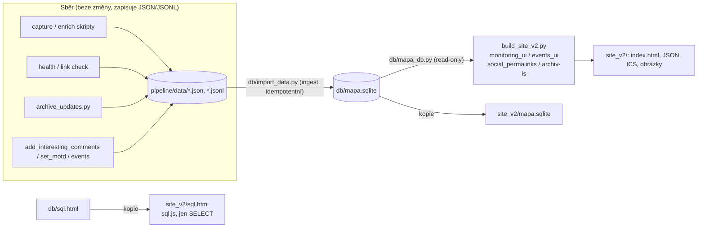

# Data mapy v SQLite (`db/mapa.sqlite`)

Větev `feature/sqlite-data`. Veškerá data, která jsou vidět na mapě (dlaždice kanálů, historie
příspěvků, komentáře, ověření, události, Zpráva dne, monitoring dostupnosti/TLS/odkazů, archivace,
X permalinky), **builder čte výhradně z SQLite databáze** `db/mapa.sqlite` přes modul
`db/mapa_db.py`. Původní JSON/JSONL soubory v `pipeline/data/` zůstávají jako *vstupní žurnál*
sběrných skriptů a do databáze se převádějí ingestem `db/import_data.py`.

## Architektura



### Spuštění

```bash
cd pipeline
./run_build.sh                     # archive_updates → import → build → archiv-is
# nebo ručně:
python3 ../db/import_data.py --root .          # JSON → db/mapa.sqlite
python3 build_site_v2.py                       # čte jen z SQLite, publikuje mapa.sqlite + sql.html
python3 ../db/roundtrip_test.py . ../db/mapa.sqlite   # kontrola bezeztrátovosti
```

Proměnné prostředí: `ACR_ROOT` (kořen pipeline), `ACR_DB` (cesta k .sqlite), `ACR_DB_DIR`
(adresář s `mapa_db.py`, výchozí `<repo>/db`), `ACR_SHOTS` (adresář screenshotů pro tabulku
`screenshots`), `ACR_RUN_ARCHIVE=1` (builder sám spustí archive_updates + import jako dříve),
`ACR_DATA_SOURCE=files` (jen `social_permalinks.py` při samostatném běhu – čtení ze souborů).

### Zápisové kroky

Sběrné skripty dál zapisují do JSON/JSONL (append-only žurnál, snadný diff v gitu, žádné riziko
souběžného zápisu do DB během dlouhých běhů). Po každém zápisovém kroku (nebo jednou před buildem)
se spustí **ingest** `db/import_data.py`, který databázi postaví celou znovu do dočasného souboru a
atomicky ji přejmenuje (`os.replace`) – opakované spuštění nad stejnými daty dá stejný obsah.
Krok `archive_updates.py` (dříve volaný uvnitř builderu se side-effectem do `updates_history.jsonl`)
je přesunut do `run_build.sh` před ingest; builder je tím čistě čtecí.

### Bezeztrátovost

Každá entita má normalizované sloupce + `ord` (pořadí ve zdroji) + `extra_json`, kam se ukládají
jen informace nutné k přesné rekonstrukci: nenamapované klíče nebo hodnoty jiného typu (`x`),
klíče s explicitním `null` (`n`), odlišné pořadí klíčů (`o`), chybějící/prázdné seznamy (`a`/`p`).
`db/roundtrip_test.py` ověřuje, že všech 17 zdrojových souborů jde z DB zrekonstruovat
**bajtově shodně** (JSON serializace včetně pořadí klíčů).

## ER diagram

```mermaid
erDiagram
  channels ||--o{ captures : "url"
  captures ||--o| capture_last_post : capture_id
  captures ||--o{ capture_hidden_links : capture_id
  captures ||--o{ capture_recent_posts : capture_id
  enrichment ||--o{ enrichment_admin_urls : url
  enrichment ||--o{ enrichment_admin_checks : url
  enrichment ||--o{ enrichment_news_pages : url
  updates ||--o{ update_urls : update_ord
  comments ||--o{ comment_reasons : comment_id
  reasons ||--o{ comment_reasons : reason
  comments ||--o| comment_engagement : comment_id
  comments ||--o| verifications : comment_id
  verifications ||--o{ verification_sources : comment_id
  events ||--o{ event_replaced_ids : event_id
  motd ||--o{ motd_items : file_date
  health_checks ||--|| tls_certs : check_id
  link_status ||--o{ link_status_sources : url
  link_status ||..o{ link_history : "url (logicky)"
  archive_links ||--o{ archive_snapshots : url
  archive_links ||..o{ archive_submit_log : "url (logicky)"
  x_post_files ||--o{ x_accounts : file
  x_accounts ||--o{ x_posts : account_id
  feeds ||--o{ feed_items : feed

  captures {
    int capture_id PK
    text url
    text status
    text last_post_title
    text last_post_date
    text screenshot_path
  }
  channels {
    text url PK
    text category
    text officiality
    text label
    text platform
  }
  updates {
    int ord PK
    text id UK
    text url
    text title
    text date_iso
    text kind
    text post_url
  }
  comments {
    text id PK
    text platform
    text channel_url
    text comment_text
    text author_type
    text comment_date_iso
  }
  verifications {
    text comment_id PK
    text status
    text verifier
    text summary
  }
  events {
    text id PK
    text title
    text type
    text start
    text end
    int all_day
    text date_precision
  }
  motd {
    text file_date PK
    text headline
    text generated_at
  }
  motd_items {
    text file_date PK
    int ord PK
    text category
    text text
  }
  health_checks {
    int check_id PK
    text date
    text url
    int up
    int http_status
    int response_ms
  }
  tls_certs {
    int check_id PK
    int ok
    text issuer_o
    text not_after
    int days_to_expiry
  }
  link_status {
    text url PK
    text status
    int http_status
    int social
    text checked_at
  }
  link_history {
    int id PK
    text date
    text url
    text status
  }
  archive_links {
    text url PK
    text wayback_browse
    text archive_is_browse
  }
  archive_snapshots {
    text url PK
    text service PK
    text status
    text snapshot_url
    text timestamp_iso
  }
  archive_submit_log {
    int id PK
    text ts
    text service
    text url
    text status
  }
  x_tweets {
    text id PK
    text handle
    text text
    text created_at
    text url
  }
```



Další tabulky bez vazeb: `meta` (hlavičky souborů – `checked_at`, `counts`, `summary`, …),
`watched_urls` (urls.json), `alt_platforms`, `url_aliases`, `permalink_hints` (zálohy captures,
comments_inbox), `motd_stats`, `daily_runs` (protokoly běhů jako JSON), `screenshots` (metadata
souborů, ne obsah).

### Integritní omezení

* PK na každé tabulce, FK s `ON DELETE CASCADE` u podřízených tabulek (`PRAGMA foreign_keys=ON`
  při importu – porušení import zastaví).
* `CHECK` výčty: `comments.platform` (fb/ig/x/yt/web/tiktok/other), `comments.author_type`
  (anon/official_account), `verifications.status`, `events.date_precision` (day/month),
  `link_status.status` a `link_history.status` (ok/login_wall/broken/unknown),
  `archive_snapshots.service` (wayback/archive_is), `archive_submit_log.service`
  (wayback/archive.today), `channels.officiality` (oficialni/neoficialni), `health_checks.up` (0/1),
  `screenshots.kind`.
* `UNIQUE`: `updates.id`, `health_checks(url, date)`, `comments.ord`, `events.ord`.
* Indexy: `captures(url)`, `updates(url)`, `updates(date_iso)`, `update_urls(url)`,
  `comments(channel_url)`, `events(start)`, `link_history(url, date)`,
  `archive_snapshots(service, status)`, `archive_submit_log(url)`, `x_tweets(handle)`.

## Ukázkové dotazy

Totéž je k dispozici v prohlížeči na `/sql.html` (sql.js, jen čtecí dotazy).

```sql
-- Kolik kanálů je v každé kategorii a kolik z nich je oficiálních
SELECT category, officiality, COUNT(*) AS kanalu
FROM channels GROUP BY 1, 2 ORDER BY 1, 2;

-- Nejaktivnější zdroje za posledních 14 dní (historie příspěvků)
SELECT source_label, COUNT(*) AS prispevku, MAX(date_iso) AS posledni
FROM updates
WHERE date_iso >= date('now', '-14 day')
GROUP BY 1 ORDER BY 2 DESC;

-- Komentáře podle důvodu zařazení (jeden komentář může mít víc důvodů)
SELECT reason AS duvod, COUNT(*) AS komentaru
FROM comment_reasons GROUP BY 1 ORDER BY 2 DESC;

-- Ověřené komentáře a výsledek fact-checku včetně počtu zdrojů
SELECT c.platform, c.channel, v.status, COUNT(s.ord) AS zdroju
FROM comments c
JOIN verifications v ON v.comment_id = c.id
LEFT JOIN verification_sources s ON s.comment_id = c.id
GROUP BY c.id ORDER BY v.checked_at DESC;

-- Certifikáty, které nejdříve vyprší (poslední den měření)
SELECT h.url, t.issuer_o, t.not_after, t.days_to_expiry
FROM health_checks h JOIN tls_certs t USING (check_id)
WHERE h.date = (SELECT MAX(date) FROM health_checks)
ORDER BY t.days_to_expiry LIMIT 10;

-- Denní dostupnost webů (kolik bylo online / offline)
SELECT date, SUM(up) AS online, COUNT(*) - SUM(up) AS offline
FROM health_checks GROUP BY date ORDER BY date DESC;

-- Nefunkční odkazy a odkud na ně mapa odkazuje
SELECT l.url, l.http_status, l.error, GROUP_CONCAT(s.source, ', ') AS zdroje
FROM link_status l LEFT JOIN link_status_sources s USING (url)
WHERE l.status = 'broken' GROUP BY l.url;

-- Historie stavu jednoho odkazu v čase
SELECT date, status, http_status FROM link_history
WHERE url = 'https://acr.mo.gov.cz/' ORDER BY ts;

-- Stav archivace podle služby
SELECT service, status, COUNT(*) AS odkazu
FROM archive_snapshots GROUP BY 1, 2 ORDER BY 1, 3 DESC;

-- Úspěšnost odesílání do Wayback Machine po dnech
SELECT substr(ts, 1, 10) AS den, status, COUNT(*) AS pokusu
FROM archive_submit_log WHERE service = 'wayback'
GROUP BY 1, 2 ORDER BY 1 DESC;

-- Nadcházející události (nábory, přijímače, veřejné akce)
SELECT start, title, type, location FROM events
WHERE start >= date('now') ORDER BY start;

-- Zprávy dne s položkami
SELECT m.file_date, m.headline, i.category, i.text
FROM motd m JOIN motd_items i USING (file_date)
ORDER BY m.file_date DESC, i.ord;

-- Weby podle redakčního systému (CMS)
SELECT COALESCE(cms, '?') AS cms, COUNT(*) AS webu FROM enrichment GROUP BY 1 ORDER BY 2 DESC;

-- Hlavičky souborů (např. kdy proběhla poslední kontrola odkazů)
SELECT key, value_json FROM meta;
```

## Ověření ekvivalence

Build nad JSON (větev `spec/kompletni-specifikace`) a build nad SQLite (tato větev) byly spuštěny
nad **stejnou kopií dat** (po jednom běhu `archive_updates.py`, aby se vyloučil jeho side-effect).
Výsledek: `diff -r` obou adresářů `site_v2/` – **všech 345 souborů bajtově shodných**
(index.html 2 442 240 B, updates_history.json, interesting_comments.json, motd.json, events.json,
events.ics, events/*.ics, archiv-is.html, náhledy a screenshoty). Kontrola počtů řádků proti
zdrojovým souborům je v tabulce níže a v `db/roundtrip_test.py` (17/17 OK).


## Počty řádků (snapshot 2026-10-30 08:41 CET)

| Tabulka | Řádků |
|---|---|
| alt_platforms | 16 |
| archive_links | 916 |
| archive_snapshots | 1832 |
| archive_submit_log | 1811 |
| capture_hidden_links | 45 |
| capture_last_post | 15 |
| capture_recent_posts | 10 |
| captures | 108 |
| channels | 108 |
| comment_engagement | 123 |
| comment_reasons | 177 |
| comments | 123 |
| daily_runs | 24 |
| enrichment | 55 |
| enrichment_admin_checks | 210 |
| enrichment_admin_urls | 210 |
| enrichment_news_pages | 78 |
| event_replaced_ids | 2 |
| events | 122 |
| feed_items | 40 |
| feeds | 1 |
| health_checks | 1911 |
| link_history | 23094 |
| link_status | 949 |
| link_status_sources | 1318 |
| meta | 7 |
| motd | 35 |
| motd_items | 192 |
| motd_stats | 280 |
| permalink_hints | 138 |
| reasons | 9 |
| screenshots | 1808 |
| tls_certs | 1911 |
| update_urls | 869 |
| updates | 617 |
| url_aliases | 1 |
| verification_sources | 42 |
| verifications | 24 |
| watched_urls | 90 |
| x_accounts | 2 |
| x_post_files | 1 |
| x_posts | 53 |
| x_tweets | 257 |

`screenshots` obsahuje jen metadata (cesta, velikost), samotné PNG zůstávají v `pipeline/screenshots/` mimo git.

Ověření ekvivalence: `db/equivalence_check.sh` postaví web ze souborů (větev spec) i z SQLite (tato větev, s odsunutým `data/`) a porovná `diff -r`.
